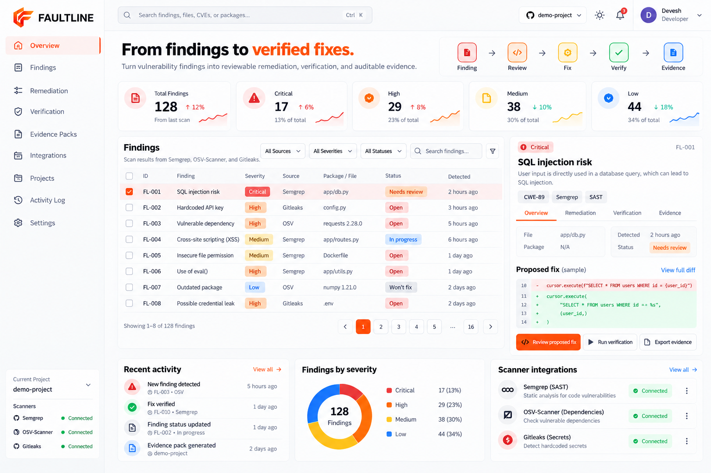

<div align="center">


# Faultline

### From vulnerability findings to verified remediation.

**Find the weakness. Engineer the fix. Verify the outcome.**

An open-source security remediation platform designed to connect vulnerability discovery, reviewable fixes, verification, and auditable evidence.

[](https://faultine.vercel.app/)
[](https://github.com/devloperdevesh/Faultline)
[](https://github.com/devloperdevesh/Faultline/blob/main/CONTRIBUTING.md)
[](LICENSE)

</div>

---

## The Problem

Finding a vulnerability is only the beginning.

Security findings often arrive from different tools and in inconsistent formats. Developers still need to understand the risk, review proposed changes, verify that the original issue is addressed, and preserve evidence of the outcome.

These steps can become fragmented across scanners, pull requests, test output, and reports.

**Faultline is being built to connect that remediation lifecycle in one inspectable workflow.**

## Product Preview



> **Conceptual dashboard preview. Displayed metrics and runtime states are illustrative, not live production data.**

The interface illustrates the intended workflow: findings, prioritization, proposed remediation, verification, and evidence. Actual capabilities depend on the implementation available in the repository.

## How It Works

| Stage | Purpose |
|---|---|
| **Discover** | Collect findings from security scanners. |
| **Normalize** | Represent findings in a consistent format. |
| **Prioritize** | Help reviewers assess severity and urgency. |
| **Remediate** | Prepare changes developers can inspect and review. |
| **Verify** | Test proposed changes against the original finding. |
| **Preserve Evidence** | Keep results and supporting artifacts traceable. |

The workflow is designed to keep developers in control. A proposed fix is not considered verified merely because a patch was generated.

## Design Principles

- **Reviewable by default:** Developers can inspect proposed changes before accepting them.
- **Verification over assumptions:** A generated patch is not proof that a vulnerability has been resolved.
- **Traceable outcomes:** Findings, diffs, test results, and reports should be connected.
- **Local-first direction:** Keep sensitive source code and scanner artifacts under the user's control wherever possible.
- **Evidence-based claims:** Publish security, performance, and reliability metrics only when reproducible measurements support them.

## Architecture

Faultline is being developed around a modular remediation workflow, with components for the API, scanner integrations, remediation, verification, and reporting.

See [ARCHITECTURE.md](ARCHITECTURE.md) for the current design and implementation details.

## Repository Structure

```text
Faultline/
├── .github/
│   ├── ISSUE_TEMPLATE/
│   └── workflows/
├── backend/
│   ├── app/
│   │   ├── ml/
│   │   ├── remediation/
│   │   ├── reports/
│   │   ├── sandbox/
│   │   ├── scanners/
│   │   ├── utils/
│   │   ├── db.py
│   │   ├── main.py
│   │   ├── models.py
│   │   └── security.py
│   ├── scripts/
│   ├── tests/
│   ├── requirements.txt
│   └── requirements-ml.txt
├── docs/
│   ├── ROADMAP.md
│   ├── THREAT_MODEL.md
│   └── faultline_dashboard.png
├── frontend/
│   ├── public/
│   └── src/
├── scripts/
├── tests/
├── ARCHITECTURE.md
├── CONTRIBUTING.md
├── SECURITY.md
├── CHANGELOG.md
├── LICENSE
└── README.md
```

Some directories may be scaffolding. Consult the repository for the current implementation rather than assuming every listed component is functional.

## Getting Started

### Requirements

- Python 3.11, subject to the version supported by the current dependencies
- Git
- pip

### Clone and Install

```powershell
git clone https://github.com/devloperdevesh/Faultline.git
Set-Location Faultline

python -m venv .venv
.\.venv\Scripts\Activate.ps1

python -m pip install -r backend/requirements.txt
```

### Run the API

```powershell
$env:PYTHONPATH = "$PWD\backend"
python -m uvicorn app.main:app --reload --app-dir backend
```

Local endpoints, if available in the current implementation:

- API root: `http://127.0.0.1:8000/`
- Health: `http://127.0.0.1:8000/health`
- API documentation: `http://127.0.0.1:8000/docs`

### Run Tests

```powershell
$env:PYTHONPATH = "$PWD\backend"
python -m ruff check backend/app tests
python -m pytest tests -v
```

Use actual test results from your current checkout when reporting test coverage or CI status.

## Development Roadmap

1. Establish a reliable backend API and automated tests.
2. Integrate security scanners and normalize findings.
3. Improve finding prioritization and triage.
4. Generate reviewable remediation proposals.
5. Verify proposed fixes against original findings.
6. Produce traceable evidence reports.
7. Strengthen CI, sandboxing, and security testing.

Roadmap items remain planned until their implementations and tests are available.

## Contributing

Contributions are welcome.

1. Read [CONTRIBUTING.md](CONTRIBUTING.md).
2. Inspect existing code and open issues.
3. Discuss substantial changes before implementation.
4. Submit focused pull requests with relevant tests and verification details.

[Browse open issues](https://github.com/devloperdevesh/Faultline/issues) · [Read the contributing guide](https://github.com/devloperdevesh/Faultline/blob/main/CONTRIBUTING.md)

## Security

Please follow [SECURITY.md](SECURITY.md) for responsible vulnerability disclosure.

Do not publish credentials, API keys, private source code, or sensitive vulnerability details in public issues or pull requests.

## License

See [LICENSE](LICENSE) for the applicable license terms. Ensure the file contains the complete license text before representing the project as open source under that license.


**Faultline** — make remediation reviewable, verifiable, and evidence-driven.

